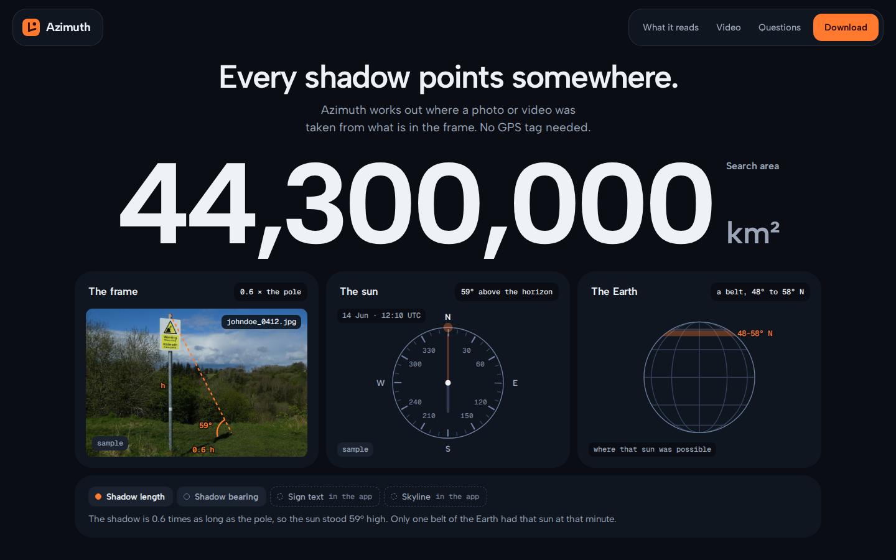
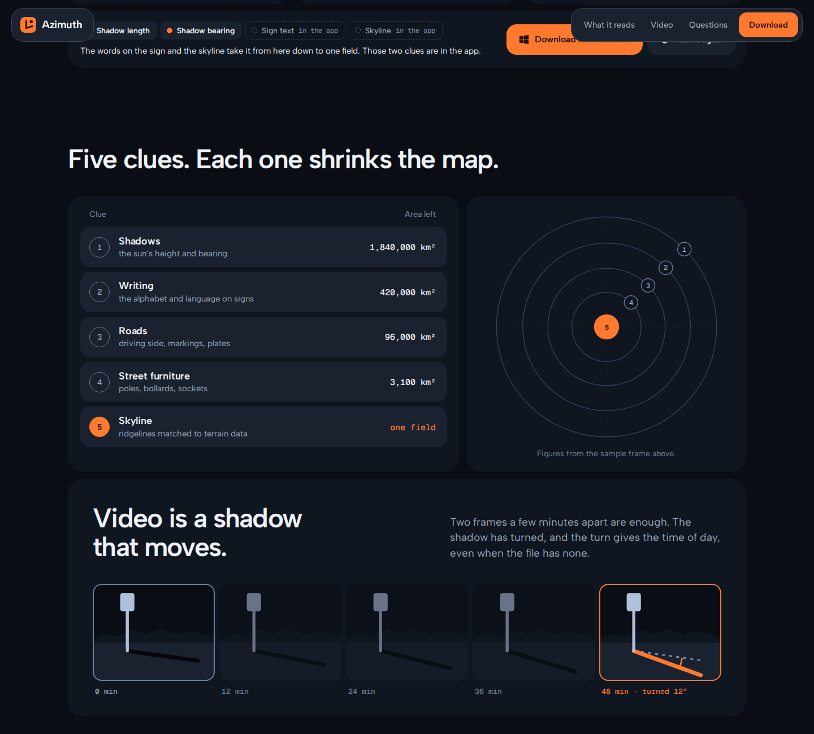
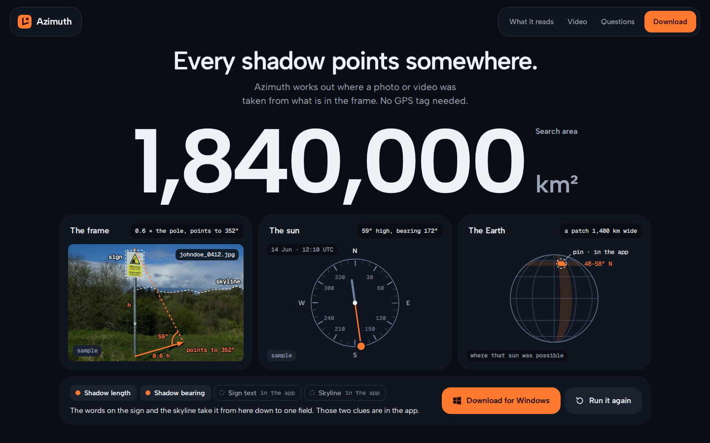

<h1 align="center">Azimuth: OSINT geolocation of photos and video</h1>

<b>Every shadow points somewhere.</b> Find where a photo or video was taken from what is in the frame.

OSINT · OSINT tool · geolocation · photo geolocation · GEOINT · IMINT · chronolocation · shadow analysis · windows

> **Status: v1.3.3.** The app is out — [download Azimuth for Windows](https://awesomeosint.tools/azimuth/).

## Why this exists

A photo is a claim, not a proof. "This was taken in Geneva" — says who? The shadows, the signs and the road paint all answer that question.

## Why it is different

Reverse image search finds copies of a photo, not places. Azimuth reads the photo itself — the sun angle from the shadows, the language of the signs — and puts a pin where they agree.

## The idea

- **One object.** A pole and its shadow. The angle between them is what the product measures.
- **One number.** The search area in km², shrinking with every clue.
- **Colour.** Dusk `#0A0E14` and white. Sun orange `#FF7A2F` marks what the shadow gave away, and the download.
- **The main feature.** It reads the shadow: its length gives the sun's height, its direction gives the sun's bearing, and with the time in the file that leaves one patch of the Earth. Signs, roads and the skyline take it from there.

## The demo on the page

Three panels play in order. The shadow in the photo is measured, the sun swings to its bearing on the dial, and the globe narrows from a belt to a patch while the search area counts down from the whole planet to 1,840,000 km². Then it stops: the words on the sign and the skyline are outlined as the two clues left, the pin is not shown, and the strip offers the download.

## Credits

The photo in the demo is [Sign-1140273, Leixlip, Co. Kildare, Ireland](https://commons.wikimedia.org/wiki/File:Sign-1140273,_Leixlip,_Co._Kildare,_Ireland.jpg) by Leimanbhradain, from Wikimedia Commons, released under CC0 (public domain). It is cropped and resized. The page itself does not name the place, so the demo keeps its ending.

There are no reviews or user counts on the page. Add real ones when you have them.

Fonts in `assets/fonts` are Albert Sans (the page typeface), Geist Mono and Inter, all under the SIL Open Font License; the licence texts sit next to them.
